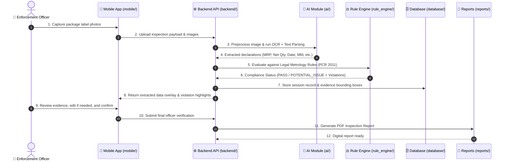

# ⚖️ Legal Metrology Compliance System

### AI-Powered Packaged Commodity Compliance & Inspection Platform

> An intelligent software system that analyzes packaged commodity images, extracts mandatory declarations, determines applicable Legal Metrology requirements, identifies potential non-compliance, and assists enforcement officers in generating digital inspection reports.

---

## 📌 Table of Contents

- [About the Project](#-about-the-project)
- [Problem Statement](#-problem-statement)
- [Our Solution](#-our-solution)
- [Project Directory Structure](#-project-directory-structure)
- [System Workflow](#-system-workflow)
- [System Architecture](#-system-architecture)
- [Module Breakdown](#-module-breakdown)
- [Technology Stack](#-technology-stack)
- [Getting Started](#-getting-started)
- [API Overview](#-api-overview)
- [Testing](#-testing)
- [License](#-license)

---

## 📖 About the Project

Packaged commodities sold in India are required to carry various mandatory declarations under the **Legal Metrology Act, 2009** and the **Legal Metrology (Packaged Commodities) Rules, 2011**, subject to applicability and prescribed exceptions.

Examples of important package information include:
- Product identity
- Net quantity
- Maximum Retail Price (MRP)
- Manufacturer / Packer / Importer details & address
- Date of manufacture / packing / import
- Consumer care information & contact details
- Country of origin

Our system automates and assists this inspection process using:
- **Computer Vision & Image Preprocessing**
- **Optical Character Recognition (OCR)**
- **Rule-based Legal Engine**
- **Product & Exemption Classification**
- **Evidence Management & Digital Sign-off**

---

## ❗ Problem Statement

> Develop a software application capable of scanning packaged commodity labels, product images, and product information to automatically assess compliance with the Legal Metrology (Packaged Commodities) Rules, 2011.

The system helps enforcement officers identify potential issues such as:
- Missing mandatory declarations
- Incorrect or incomplete MRP formatting
- Readability & font height non-compliance
- Exemption status misclassification
- Omission of manufacturer/importer or consumer care details

*Note: The final legal decision remains with the authorized enforcement process/officer.*

---

## 💡 Our Solution

We propose a modular, scalable monorepo platform architecture:

```text
📦 Package Label Image
     ↓
📱 mobile/ (Field Inspection Capture) / 🖥️ dashboard/ (Web Batch Upload)
     ↓
⚙️ backend/ (API Gateway & Queue Dispatch)
     ↓
🤖 ai/ (Image Preprocessing -> OCR -> Key-Value Field Extraction)
     ↓
⚖️ rule_engine/ (Applicability Check -> Legal Metrology Rule Validation)
     ↓
🗄️ database/ (Persistence of Session & Bounding Box Evidence)
     ↓
👮 Officer Verification & Audit
     ↓
📄 reports/ (Automated PDF Inspection Report & Violation Notice)
```

---

## 📁 Project Directory Structure

```text
legal-metrology/
│
├── 📱 mobile/               # Mobile App (Field Inspection Officer interface)
│   ├── src/                 # Screen components, camera logic, offline sync
│   ├── assets/              # App icons, static resources
│   ├── package.json         # Node dependencies
│   └── tsconfig.json        # TypeScript configuration
│
├── 🖥️ dashboard/            # Web Dashboard (Admin & Senior Officer portal)
│   ├── src/                 # React/Next.js dashboard components & analytics
│   ├── public/              # Static public assets
│   ├── package.json         # Web dependencies
│   └── tsconfig.json        # TypeScript configuration
│
├── 🔗 shared/               # Shared Utilities & Interfaces
│   ├── types/               # TypeScript interfaces & types
│   ├── constants/           # Legal constants & mandatory field lists
│   └── validation/          # Common schema validation rules
│
├── ⚙️ backend/              # Core API Server (Python FastAPI)
│   ├── app/                 # FastAPI routes, ORM schemas, controller logic
│   └── requirements.txt     # Python dependencies
│
├── 🤖 ai/                   # AI & Vision Processing Pipeline
│   ├── ocr/                 # OCR detection & text bounding box engine
│   ├── extraction/          # Named entity parsing & structured declaration extraction
│   └── image_processing/    # Image enhancement, deskewing, binarization
│
├── ⚖️ rule_engine/          # Legal Metrology Compliance Engine
│   ├── rules/               # Packaged Commodity Rules 2011 validators
│   ├── applicability/       # Small-pack & net quantity exemption checkers
│   └── validators/          # Font size, numeral height, & format checkers
│
├── 🗄️ database/             # Relational Database Schemas & Migrations
│   ├── schema.sql           # PostgreSQL schema DDL
│   └── README.md            # Database documentation
│
├── 📄 reports/              # PDF & Digital Inspection Notice Generators
│   ├── generator.py         # PDF report generator logic
│   └── templates/           # HTML/Jinja2 report templates
│
├── 🧪 tests/                # Test Suites
│   ├── test_ai_pipeline.py  # AI & OCR tests
│   ├── test_rule_engine.py  # Compliance rule tests
│   └── test_api.py          # API route integration tests
│
├── 📚 docs/                 # Detailed Documentation
│   └── WORKFLOW.md          # End-to-end system workflow guide
│
├── .env.example             # Configuration environment variables template
├── .gitignore               # Git ignore rules
└── README.md                # Project overview documentation
```

---

## 🔄 System Workflow



For full details on each stage, refer to [docs/WORKFLOW.md](file:///d:/SIH_project_2026/docs/WORKFLOW.md).

---

## 🛠️ Technology Stack

| Layer | Technologies |
| :--- | :--- |
| **Mobile App** | React Native / TypeScript, Expo Camera, Offline SQLite |
| **Web Dashboard** | React.js / Next.js, Tailwind CSS / Vanilla CSS |
| **Backend API** | Python, FastAPI, Uvicorn, Pydantic, SQLAlchemy |
| **AI / Computer Vision** | OpenCV, PyTesseract / EasyOCR, Transformers, LayoutLM |
| **Rule Engine** | Python custom rule evaluation pipeline |
| **Database** | PostgreSQL, PostGIS (Geospatial inspection mapping) |
| **Reports** | WeasyPrint / ReportLab (PDF Generation), Jinja2 HTML Templates |

---

## 🚀 Getting Started

### Prerequisites
- Node.js (>= v18)
- Python (>= 3.10)
- PostgreSQL (>= 14)

### Setup Instructions

1. **Clone the Repository**:
   ```bash
   git clone https://github.com/chandumaddula/SIH_project_2026.git
   cd SIH_project_2026
   ```

2. **Set up Environment Variables**:
   ```bash
   cp .env.example .env
   ```

3. **Backend & AI Setup**:
   ```bash
   cd backend
   python -m venv venv
   source venv/bin/activate  # On Windows: venv\Scripts\activate
   pip install -r requirements.txt
   ```

4. **Shared Types Setup**:
   ```bash
   cd ../shared
   npm install
   npm run build
   ```

5. **Running backend API**:
   ```bash
   cd ../backend
   uvicorn app.main:app --reload --port 8000
   ```

---

## 🧪 Testing

Run test suites using Python `unittest` or `pytest`:

```bash
python -m unittest discover tests
```

---

## 📄 License

This project is licensed under the MIT License - see the LICENSE file for details.