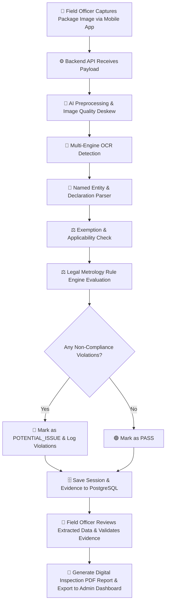

# 🔄 End-to-End System Workflow Documentation

This document describes the end-to-end functional and data workflow of the **Legal Metrology AI Compliance & Inspection Platform**.

---

## Workflow Overview Diagram

---

## Detailed Step-by-Step Execution Flow

### Stage 1: Inspection & Image Capture (`mobile/`)
1. **Officer Authentication**: Enforcement officer logs into the mobile inspection application.
2. **Metadata Capture**: Geolocation, timestamp, retail/warehouse location details are bound to the inspection session.
3. **Multi-Angle Photo Capture**: Front label, side declarations, MRP stamp, and net quantity panels are photographed.

### Stage 2: Ingestion & Storage (`backend/` & `database/`)
1. **API Ingestion**: API endpoint `/api/v1/inspect` receives image payload.
2. **Persistence**: Images uploaded to secure object storage (S3/local media store), and session record initialized in PostgreSQL.

### Stage 3: AI Processing Pipeline (`ai/`)
1. **Image Preprocessing (`ai/image_processing/`)**: Deskewing, shadow removal, orientation detection, contrast normalization.
2. **OCR Detection (`ai/ocr/`)**: Text region localization and character extraction returning bounding boxes.
3. **Structured Declaration Extraction (`ai/extraction/`)**: Field mapping to canonical keys:
   - `MRP`
   - `NET_QUANTITY`
   - `MFG_OR_PACK_DATE`
   - `MANUFACTURER_DETAILS`
   - `COUNTRY_OF_ORIGIN`
   - `CONSUMER_CARE`

### Stage 4: Legal Rule Engine Evaluation (`rule_engine/`)
1. **Applicability Check (`rule_engine/applicability/`)**: Determines if commodity is exempt (e.g. net quantity $\le 10\text{g}$, industrial package).
2. **Mandatory Declaration Verification (`rule_engine/rules/`)**: Ensures all required fields under PCR 2011 are present.
3. **Formatting & Font Validation (`rule_engine/validators/`)**: Verifies numeral height and mandatory phrases (e.g., *"Inclusive of all taxes"*).

### Stage 5: Officer Verification & Report Generation (`reports/` & `dashboard/`)
1. **Evidence Highlight**: Visual bounding boxes overlay raw package images on mobile/dashboard UI for officer audit.
2. **Digital Sign-Off**: Officer confirms/overrides results and appends digital signature.
3. **Report Compilation (`reports/`)**: Automated PDF report generated with legal citations for notice generation.
