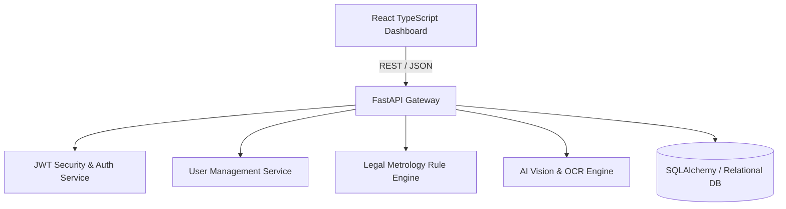

# Legal Metrology Compliance System - System Architecture

## Architecture Overview

The Legal Metrology Compliance System is designed as a modular, high-performance platform for auditing and enforcing compliance with the **Legal Metrology Act, 2009** and the **Legal Metrology (Packaged Commodities) Rules, 2011 (PCR 2011)**.

---

## Workspace Directory Organization

- **`dashboard/`**: Vite + React + TypeScript frontend web application providing role-tailored dashboards for **Citizens**, **Enforcement Officers**, **Organisations / Manufacturers**, and **System Administrators**.
- **`backend/`**: Python FastAPI backend service managing JWT authentication, SQLite/PostgreSQL persistence, and REST endpoints.
- **`docs/`**: Technical architecture and workflow specification documents.

---

## Authentication & Authorization Model

The platform enforces Role-Based Access Control (RBAC):

| Role | Access Level | Responsibilities |
| :--- | :--- | :--- |
| **Citizen** | Public / Consumer | Scan package labels, report non-compliant goods, view scan history. |
| **Officer** | Field Enforcement | Audit inspection queues, verify OCR evidence, issue digital violation notices. |
| **Organisation** | Manufacturer / Importer | Submit pre-market label artwork, request PCR 2011 compliance certificates. |
| **Admin** | System Operator | Configure legal rules, manage user accounts, monitor system health and audit logs. |

---

## Data Model & ORM Schema

The database uses SQLAlchemy to model key entities:

- **User**: Stores credentials (`email`, `hashed_password`), role enum (`citizen`, `officer`, `organisation`, `admin`), department, organisation name, and active status.
- **Inspection & Evidence**: Tracks package label images, bounding box coordinates for mandatory declarations (MRP, Net Qty, Date, Manufacturer), and legal compliance evaluation results.
